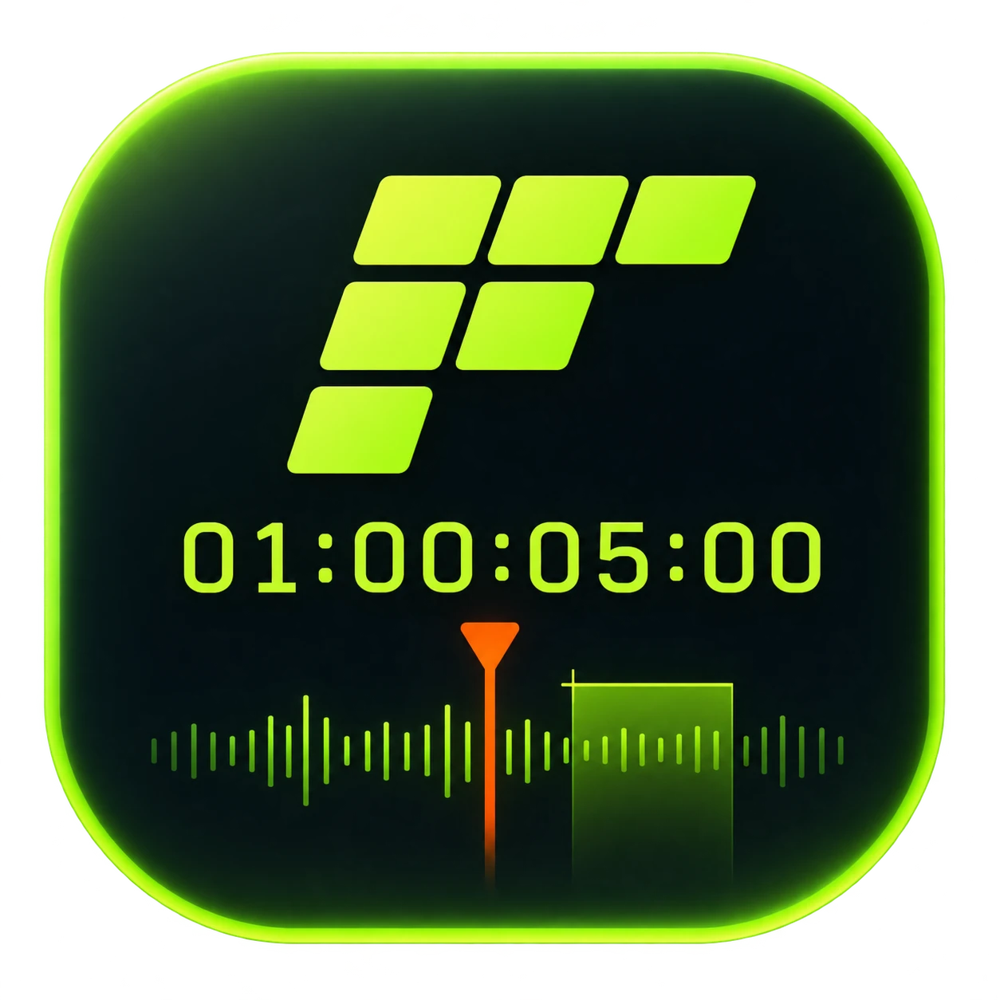
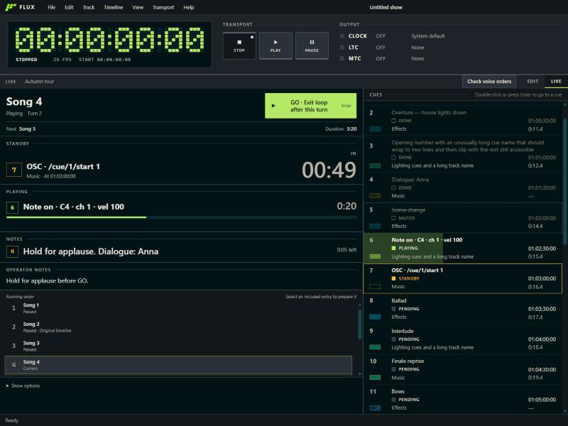
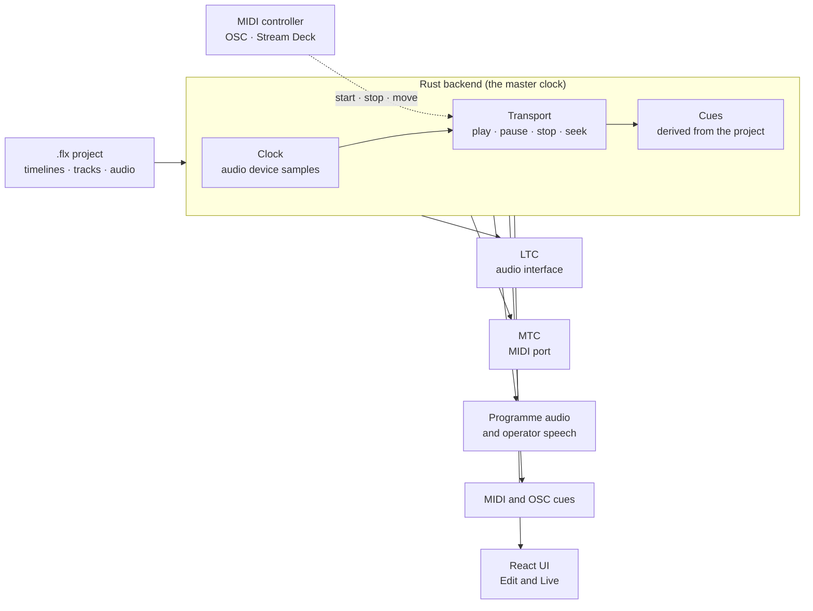

<div align="center">



# FLUX

**Build the show. Run the show. Trust the clock.**

A desktop app that turns songs, events and cues into one project with a master timecode clock:
QLab's cue model on a REAPER-style timeline.

<p>
  
  
  
  
  
  
</p>

[Features](#features) ·
[How it works](#how-it-works) ·
[Getting started](#getting-started) ·
[Documentation](#documentation) ·
[Status](#status)

<br>



<sub>The Live view, rendered with sample show data.</sub>

</div>

<br>

## Why FLUX

Cue-based tools run cues without a real timeline. Timeline tools give you the timeline without show control.
FLUX puts both in one place, and the timecode is generated from the same project that holds the audio and the cues,
so what you see on screen and what goes out to the rig can never disagree.

It is built for three people who share one project file:

| | |
| --- | --- |
| **Show technicians** | Lighting, video and sound operators who sync equipment to timecode, in a dark booth, under pressure, reading the screen from across the room. |
| **Musicians** | Players running backing tracks who need audio and the show's cues locked together. |
| **Show designers** | People building the show ahead of time in the studio, with room to think. |

## Features

### Edit

- **Timeline and tracks.** Several timelines per project, each with its own tracks, frame rate and start offset.
  Audio, notes, MIDI and OSC tracks.
- **Audio.** Import wav, aiff, flac, mp3 and ogg, play them mixed on the audio device's clock, with tempo detection
  and a metronome click.
- **Spoken operator tracks.** Write dialogue and attach generated speech (ElevenLabs, with your own API key) or
  imported and microphone-recorded audio. Generated speech is archived in the project, so it plays offline.
- **Per-track routing.** Send each track to a named destination or to Silent, and let each computer map destinations
  to its own interfaces and channels.

### Output

- **LTC** through an audio interface and **MTC** through a MIDI port, at 24, 25, 29.97 drop-frame and 30 fps.
- **Cues from the same clock.** MIDI tracks (notes, control and program change, MIDI Show Control, SysEx) and OSC
  tracks (UDP) fire in step with the timecode. Seeking never replays the events it jumped over.
- **Cue sheet.** File → Export writes the cue list for the active timeline or all of them as a CSV for a
  spreadsheet or a print-ready HTML page, for the people who work from paper instead of the FLUX screen.
- **Hardware is a normal state.** A missing device is explained and fixable, and never blocks opening a project.

### Run

- **Live view.** A read-only operating screen: a timecode you can read at a glance, the running cue with its
  countdown, what is on standby, the operator notes and the whole cue list. The backend derives the cues and their
  state, so the screen only draws it.
- **Setlists.** Order timelines into a show with repeated or omitted entries, manual or automatic transitions, waits,
  and loops with devamp. Audio, cues and timecode repeat together, driven by a GO action.
- **Remote control.** Start, stop, move between cues and timelines, and switch views from a MIDI controller (pads
  learned by touching them) or from OSC over UDP and TCP, for example a Stream Deck. FLUX stays the master clock;
  it never follows another.

### Everywhere

- **Portable projects.** A `.flx` file is a zip with `project.json` and the bundled audio, so a show opens on
  another machine and just works.
- **English and Spanish.** Every string is translatable, with the language saved per computer.
- **Built-in diagnostics.** A rotating log and a one-click zip of logs plus a system and device report, from the
  Help menu.

## How it works

The audio device's sample clock drives everything. Playback, LTC, MTC and cues are all read from the same position,
so the time you see is the time you send.



**The backend does the thinking, the frontend does the showing.** All logic and every complex operation lives in
Rust: validation, editing, ordering, cue state, countdowns, timing, devices and file formats. The UI renders what
the backend sends and forwards the user's intent.

## Getting started

FLUX is not packaged for download yet, so for now you run it from source.

**Prerequisites**

- [Node.js](https://nodejs.org/) and npm
- The [Rust toolchain](https://rustup.rs/) (edition 2024)
- The [Tauri v2 system dependencies](https://v2.tauri.app/start/prerequisites/) for your platform
- For real output: an audio interface (LTC and programme audio) and/or a MIDI interface (MTC and MIDI cues)

**Run it**

```bash
npm install
npm run tauri dev
```

**Build a bundle**

```bash
npm run tauri build
```

**Check your changes**

```bash
npm run typecheck   # TypeScript
npm test            # frontend unit tests
```

```bash
cd src-tauri
cargo fmt --all --check
cargo clippy --workspace --all-targets
cargo test --workspace
```

> [!NOTE]
> Test FLUX through `npm run tauri dev`, not the Vite dev server in a browser. The UI depends on the Rust backend
> for cues, transport, devices and project files, and it only behaves truthfully inside Tauri.

## Project layout

```text
src/             React + TypeScript UI (Edit, Live, preferences, i18n)
src-tauri/       Tauri app crate and Cargo workspace root
  crates/        Logic that does not depend on Tauri
branding/        Logo and app icon
docs/            Specs and guides
```

| Crate | Holds |
| --- | --- |
| `flux-core` | Frame rates, timecode and the sample clock. |
| `flux-project` | The `.flx` / `.fxtc` model, archive, migrations and the editing session. |
| `flux-audio` | Decoding, waveform peaks and tempo detection. |
| `flux-engine` | Transport, LTC and MTC, mixer, cues, outputs, device lookup and cue firing. |
| `flux-voice` | Speech generation for operator tracks. |

## Documentation

The guides are published at [blad3mak3r.github.io/flux/docs](https://blad3mak3r.github.io/flux/docs/), built from
the files below.

| Guide | Covers |
| --- | --- |
| [Project format](docs/fxtc-format.md) | The `.flx` / `.fxtc` archive: layout, fields and versioning. |
| [Timecode signals](docs/timecode-signals.md) | How LTC and MTC are encoded and sent. |
| [Setlists and show operation](docs/setlists.md) | Preparing and running a setlist, GO and transitions. |
| [Remote control](docs/remote-control.md) | MIDI controllers and OSC as a remote. |
| [OSC API](docs/osc-api.md) | The `/flux/...` addresses, queries and feedback. |
| [Audio routing](docs/audio-routing.md) | Per-track destinations and per-computer interfaces. |
| [Voice operator](docs/voice-operator.md) | Spoken operator tracks. |
| [Diagnostics](docs/diagnostics.md) | Logs and the diagnostics export. |
| [Releasing](docs/releasing.md) | Publishing a version and how the app updates itself. |

Product intent and visual language live in [PRODUCT.md](PRODUCT.md) and [DESIGN.md](DESIGN.md).

## Status

FLUX is in early development (`0.2.0`).

| Available today | Not built yet |
| --- | --- |
| `.flx` projects with several timelines | Video cues |
| Audio and notes tracks, tempo detection, metronome | Art-Net cues |
| LTC and MTC generation, with a full transport | Chasing an external timecode |
| MIDI and OSC cue tracks | Feedback to a controller's lights |
| Live view and setlists with GO | macOS release builds |
| Spoken operator tracks | |
| MIDI and OSC remote control | |

## Contributing

Read [AGENTS.md](AGENTS.md) first: it covers the architecture rules, conventions, the testing approach and the git
workflow. In short, code, docs and commit messages are in English, work happens on a branch and goes through a pull
request, and every user-facing string goes through `src/i18n`.

## License

FLUX is licensed under the GNU General Public License, version 3 or (at your option) any later version.
See [LICENSE](LICENSE).

The Windows build includes the Steinberg ASIO SDK (`third_party/asiosdk`), used under its GPLv3 option. ASIO is a trademark of Steinberg Media Technologies GmbH.
