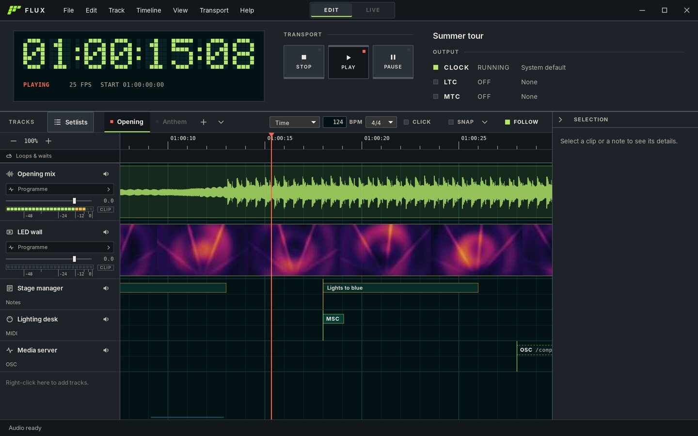
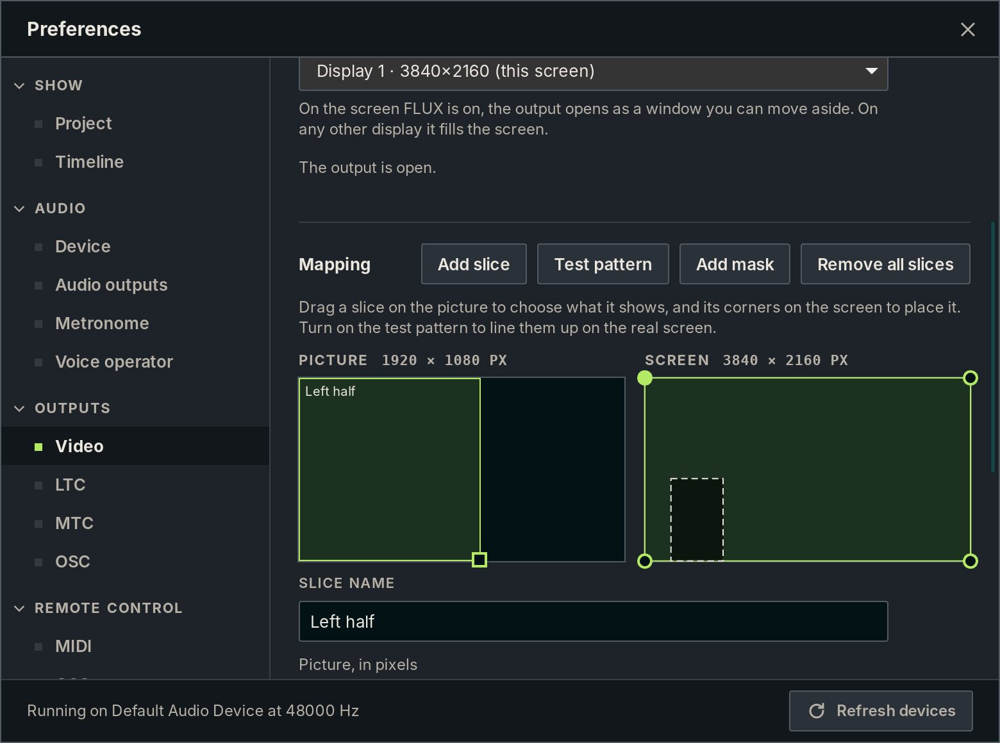
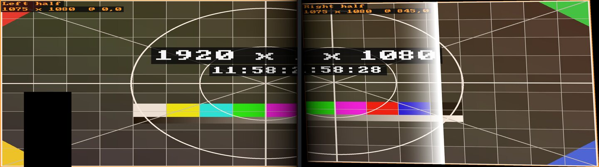

# Video and projection mapping

FLUX plays video clips on the timeline, locked to the same clock as the timecode, and sends the picture to one or more
displays or projectors. Each output can be cut into slices, bent to fit the surface it lands on, blended with the
projector next to it and masked. This guide covers the whole path, from importing a file to lining up the projectors on
stage. How the decoding works and what building FLUX needs is in [Video decoding](video.md).

## Clips on the timeline

**File > Import > Video** adds a file on a new video track of the active timeline, with a clip at the playhead. FLUX
reads MP4, M4V, MOV and WebM (VP8, VP9 or AV1). A file it cannot read is refused with the reason. Transparency is kept:
a WebM with alpha, or a MOV in ProRes 4444, HAP Alpha or QuickTime Animation, shows the tracks below where it is
transparent, and black where nothing is below. The file is **not** copied into the project: the show refers to it by
path, so a video of several GB never bloats the `.flx` (see [Media and offline files](#media-and-offline-files)).

A video clip is edited like an audio clip: drag it to move it, drag its edges to trim it, split it at the playhead and
delete it. It shows thumbnails of the picture and, under them, the waveform of its sound and the tempo found in it.

The sound of the video plays with the clip. The video track has a fader, a meter and an output in the routing, like an
audio track: pulling the fader down silences the sound and keeps the picture, and muting the track takes both away.

**Fit** in the clip's inspector chooses how its picture is sized into the composition (see [Composition](#composition)):

- **Fit** shows the whole picture as large as it goes, keeping its shape, with black bars where it does not reach.
- **Fill** covers the whole composition, keeping its shape and cropping what reaches past it.
- **Stretch** takes exactly the composition, changing the picture's shape if it has to.
- **No fit** keeps the video at its own size in pixels, centred: smaller than the composition leaves black around it,
  larger is cropped.

The picture follows the transport frame by frame. It is black while stopped, before a clip and after it. When two video
tracks overlap, the upper track covers the lower one wherever its picture is; around a clip that does not fill the
composition, the track below shows.

### Fades

The small squares at the top corners of a video clip set its fades, as on an audio clip: drag the left one in for a fade
in, the right one for a fade out. A clip fades in from black, or from whatever the tracks below show, and fades out the
same way, and its sound fades with it. To cross-fade two clips, overlap them, on one track or on two, and fade in the
one that starts later: while it fades, the clip under it shows through.

## Composition

The **composition** is the picture every clip is sized into and every slice is cut from. It is the size of the
project's first video until **Preferences > Outputs > Video > Composition** sets one of its own, for example 3840 × 1080
for two 1920 × 1080 projectors side by side: each clip is then fitted, filled or stretched into it as its **Fit** says.
**Use the video's size** goes back to the first video's size. The composition belongs to the project.

## Screens

Video outputs are set up in **Preferences > Outputs > Video**. Each **screen** is one output: a window on a display of
its own, with its own slices and masks. Every project has one screen; **Add screen** adds more, up to eight, for example
one per projector. The tabs at the top choose the screen being edited, and the dot on a tab is lit while its window is
open. The **Output to this screen** switch turns a screen off without closing it: its window stays where it is and shows black, until the switch is turned back on. A screen can be renamed (its window title follows) and removed, except the first one.

**Display** chooses where the screen opens. On a display that already has a FLUX window, the screen opens as a window you
can move aside, so it never covers the editor; on any other display it fills the screen. **Off** closes it.

The screens, their slices and masks belong to the project and travel with it. Which display each screen opens on is a
setting of the computer, like the audio devices, so a show opened on another machine only needs its displays chosen
again. Every screen draws from the same decoded video, so adding screens does not decode a clip again.

Show check warns when a show has video clips and every screen is off, and reports an error when a screen's display is
not connected.

## Slices

With no slices, the whole composition is fitted to the screen, keeping its shape. **Add slice** cuts the picture into parts
and places each one where it goes, as the advanced output of a media server does:

- **Picture** (left) is the video. Drag the slice to choose which part of it the slice shows, and its corner to resize it.
- **Screen** (right) is the output. Drag each of the four corners to place the slice; moving one corner on its own leans
  the slice to fit a surface seen at an angle, and dragging inside the shape moves it whole.

Each stage shows its size in pixels: the picture in the size of the composition, the screen in the size of the chosen
display. Below the stages, the selected slice's rectangle (**X**, **Y**, **Width**,
**Height**) and its corners can be typed in those pixels instead of dragged.

A slice can be renamed, hidden without losing its place, or have its corners put back where its rectangle is
(**Reset corners**). **Remove all slices** goes back to the whole picture. Every drag and typed value is one undo step.

The mapping is kept in fractions of the picture and the screen, so it keeps its shape when the show moves to a display
with another resolution.

## Test pattern

**Test pattern** shows a test card on every screen wherever there is no picture, to line the slices up on the real
surface. Each slice has a card of its own, drawn in the slice's pixels: a checker of cabinets in the slice's colour with a
grid you set to the size of the LED cabinets (128 x 128 by default), cabinet ids, a circle and diagonals, the slice's name
and resolution, colour bars and a moving clock and frame counter. Its settings are in **Advanced Output > the slice > Test
card**; see [The test card](./vj-mode.md#the-test-card) for all of them.

Turn it off before the show: it is only drawn where no clip is showing, but it is meant for setting up.

## Soft edge

When two projectors overlap to make one wider picture, the overlap is twice as bright. **Soft edge** fades a slice to
black over a percentage of its width or height from each side (**Left**, **Right**, **Top**, **Bottom**), so the two
pictures blend into one:

1. Give both slices the same part of the picture in the overlap, so they show the same image there.
2. Set the fade on the side that overlaps on each one: right on the left projector, left on the right one, at the
   overlap's share of the slice.
3. Adjust **Curve** until the overlap is as bright as the rest. 1 dims the light evenly; higher keeps it brighter for
   longer, lower makes it darker sooner. Most projectors land between 1.5 and 2.5.

## Masks

A mask blacks out a shape on one screen, over every slice: a door, a speaker stack, a part of the set the projector
should not light. **Add mask** puts a square on the screen stage:

- Drag its points to shape it, or drag inside it to move it whole.
- **Add point** puts a new point after the selected one; **Remove point** takes the selected one away, down to three.
- **Invert** blacks out everything but the shape, to keep the picture inside it.
- **Hide** turns the mask off without losing it. **Delete mask** removes it.

A screen has up to 8 masks of up to 32 points.

## Converting to HAP

Large files and shows with several layers play best in **HAP**, the codec media servers use: every frame stands on
its own, so jumping anywhere in the clip is instant. Select a video clip and press **Convert to HAP** in the inspector;
it shows how far it has got and can be cancelled. The copy (`<name> (HAP).mov`, beside the original file) keeps the
same frames, rate and sound, and HAP Alpha keeps the transparency of a transparent clip. When it is done, every clip of
that video uses the copy, with its place, trim, fit and fades unchanged; **Undo** goes back to the original. HAP files
are much larger than H.264, so they take more room on disk. The copy is written beside the original and linked; if that
folder cannot be written, the conversion says so instead of putting the copy somewhere else.

## Media and offline files

Audio, videos and images are **linked, not stored**: importing a file adds a reference to where it is, like a media
server does, and the `.flx` stays small. Moving the show to another computer therefore needs its media too, which is what
**Collect media** is for.

- **File > Media…** lists every file of the project (name, kind, state, file and how many clips use it). The status bar
  shows a vermilion **N offline** button whenever a file is missing; opening a project never stops for one and never asks.
- An **offline** file shows on the timeline and in the grid with its name over a dim striped background and an
  **Offline** label. It plays nothing (black, silence) and the rest of the show keeps working. The inspector shows its
  path and a **Relink…** button.
- **Relink…** (on a row, or in the inspector) picks the file that replaces a missing one, which must be the same kind of
  media. Every other missing file whose name is in the same folder is relinked with it.
- **Search folder…** looks in a folder, and the folders under it, for every missing file by name (not case sensitive)
  and relinks what it finds. It says how many are still missing. Relinking is one step of **Undo**.
- **Collect media…** (the project must be saved) copies every file into a folder called `<project name> Media` next to the
  project file, takes the media of an older project out of the `.flx`, and links them there. A progress bar shows the
  copy of big files. Save afterwards to keep it. The folder and the `.flx` then move together: the project also
  stores each path relative to its own file, so it finds its media again after being moved.
- Projects from earlier versions keep their media inside the `.flx` and open as before ("In project" in the list).
  Collect media turns them into linked files. Speech made by the voice operator always stays inside the project.

## Decoding on the graphics card

FLUX decodes H.264, HEVC, VP9 and AV1 clips on the graphics card when the computer has a decoder for them (Direct3D 11
on Windows, VideoToolbox on macOS, VA-API or NVIDIA on Linux), which leaves the processor free and plays large
files smoothly. When the card cannot take a file, it is decoded on the processor instead, without a break.
**Preferences > Outputs > Video** says which one is in use while a clip is open.

## Running the show

Choose each screen's display before the show and run Show check. The windows open with the project and follow the
transport and the setlist like the timecode: whatever timeline plays is the one whose video shows. If an output window
is closed by hand, choose its display again to reopen it.
