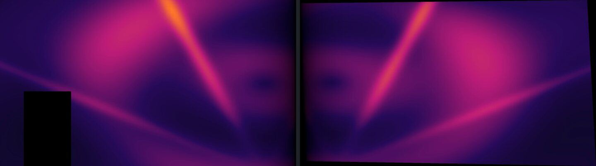

# Video and projection mapping

FLUX plays video clips on the timeline, locked to the same clock as the timecode, and sends the picture to one or more
displays or projectors. Each output can be cut into slices, bent to fit the surface it lands on, blended with the
projector next to it and masked. This guide covers the whole path, from importing a file to lining up the projectors on
stage. How the decoding works and what building FLUX needs is in [Video decoding](video.md).

## Clips on the timeline

**File > Import > Video** adds a file on a new video track of the active timeline, with a clip at the playhead. FLUX
reads MP4, M4V, MOV and WebM (VP8, VP9 or AV1). A file it cannot read is refused with the reason. The file is copied into
the project when it is saved, so the show stays self-contained.

A video clip is edited like an audio clip: drag it to move it, drag its edges to trim it, split it at the playhead and
delete it. It shows thumbnails of the picture and, under them, the waveform of its sound and the tempo found in it.

The sound of the video plays with the clip. The video track has a fader, a meter and an output in the routing, like an
audio track: pulling the fader down silences the sound and keeps the picture, and muting the track takes both away.

**Fit** in the clip's inspector chooses how its picture is sized into the composition (see [Composition](#composition)):

- **Fit** shows the whole picture as large as it goes, keeping its shape, with black bars where it does not reach.
- **Fill** covers the whole composition, keeping its shape and cropping what reaches past it.
- **Stretch** takes exactly the composition, changing the picture's shape if it has to.
- **No fit** keeps the video at its own size in pixels, centred: smaller than the composition leaves black around it,
  larger is cropped.

The picture follows the transport frame by frame. It is black while stopped, before a clip and after it. When two video
tracks overlap, the upper track is the one shown.

## Composition

The **composition** is the picture every clip is sized into and every slice is cut from. It is the size of the
project's first video until **Preferences > Outputs > Video > Composition** sets one of its own, for example 3840 × 1080
for two 1920 × 1080 projectors side by side: each clip is then fitted, filled or stretched into it as its **Fit** says.
**Use the video's size** goes back to the first video's size. The composition belongs to the project.

## Screens

Video outputs are set up in **Preferences > Outputs > Video**. Each **screen** is one output: a window on a display of
its own, with its own slices and masks. Every project has one screen; **Add screen** adds more, up to eight, for example
one per projector. The tabs at the top choose the screen being edited, and the dot on a tab is lit while its window is
open. A screen can be renamed (its window title follows) and removed, except the first one.

**Display** chooses where the screen opens. On a display that already has a FLUX window, the screen opens as a window you
can move aside, so it never covers the editor; on any other display it fills the screen. **Off** closes it.

The screens, their slices and masks belong to the project and travel with it. Which display each screen opens on is a
setting of the computer, like the audio devices, so a show opened on another machine only needs its displays chosen
again. Every screen draws from the same decoded video, so adding screens does not decode a clip again.

Show check warns when a show has video clips and every screen is off, and reports an error when a screen's display is
not connected.

## Slices

With no slices, the whole composition is fitted to the screen, keeping its shape. **Add slice** cuts the picture into parts
and places each one where it goes, as the advanced output of a media server does:

- **Picture** (left) is the video. Drag the slice to choose which part of it the slice shows, and its corner to resize it.
- **Screen** (right) is the output. Drag each of the four corners to place the slice; moving one corner on its own leans
  the slice to fit a surface seen at an angle, and dragging inside the shape moves it whole.

Each stage shows its size in pixels: the picture in the size of the composition, the screen in the size of the chosen
display. Below the stages, the selected slice's rectangle (**X**, **Y**, **Width**,
**Height**) and its corners can be typed in those pixels instead of dragged.

A slice can be renamed, hidden without losing its place, or have its corners put back where its rectangle is
(**Reset corners**). **Remove all slices** goes back to the whole picture. Every drag and typed value is one undo step.

The mapping is kept in fractions of the picture and the screen, so it keeps its shape when the show moves to a display
with another resolution.

## Test pattern

**Test pattern** shows a test card on every screen wherever there is no picture, to line the slices up on the real
surface. It has:

- a grid, the diagonals and two circles, which show how a slice leans;
- colour bars and a grey ramp;
- a coloured corner in each corner of the picture: red top left, green top right, blue bottom right, yellow bottom
  left;
- the picture's size and the time of day in the middle;
- each slice outlined in a colour of its own, with its name, size and position in pixels;
- a white bar that sweeps across every three seconds, so each slice shows which way its part of the picture runs. The
  sweep and the clock are in step on every screen.

Turn it off before the show: it is only drawn where no clip is showing, but it is meant for setting up.

## Soft edge

When two projectors overlap to make one wider picture, the overlap is twice as bright. **Soft edge** fades a slice to
black over a percentage of its width or height from each side (**Left**, **Right**, **Top**, **Bottom**), so the two
pictures blend into one:

1. Give both slices the same part of the picture in the overlap, so they show the same image there.
2. Set the fade on the side that overlaps on each one: right on the left projector, left on the right one, at the
   overlap's share of the slice.
3. Adjust **Curve** until the overlap is as bright as the rest. 1 dims the light evenly; higher keeps it brighter for
   longer, lower makes it darker sooner. Most projectors land between 1.5 and 2.5.

## Masks

A mask blacks out a shape on one screen, over every slice: a door, a speaker stack, a part of the set the projector
should not light. **Add mask** puts a square on the screen stage:

- Drag its points to shape it, or drag inside it to move it whole.
- **Add point** puts a new point after the selected one; **Remove point** takes the selected one away, down to three.
- **Invert** blacks out everything but the shape, to keep the picture inside it.
- **Hide** turns the mask off without losing it. **Delete mask** removes it.

A screen has up to 8 masks of up to 32 points.

## Decoding on the graphics card

FLUX decodes H.264, HEVC, VP9 and AV1 clips on the graphics card when the computer has a decoder for them (Direct3D 11
on Windows, VideoToolbox on macOS, VA-API or NVIDIA on Linux), which leaves the processor free and plays large
files smoothly. When the card cannot take a file, it is decoded on the processor instead, without a break.
**Preferences > Outputs > Video** says which one is in use while a clip is open.

## Running the show

Choose each screen's display before the show and run Show check. The windows open with the project and follow the
transport and the setlist like the timecode: whatever timeline plays is the one whose video shows. If an output window
is closed by hand, choose its display again to reopen it.
