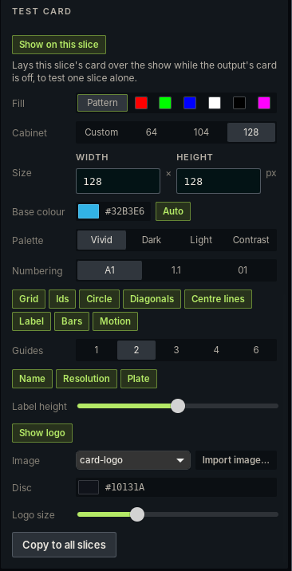

# VJ mode

VJ mode turns FLUX into a clip launcher for video, in the manner of a media server: a grid of clips you launch by hand,
layers mixed into one composition, and that composition sent to your screens. This page is the overview. The details
are in three reference pages:

- [VJ effects](vj-effects.md): all 39 effects, their settings and the effect stacks.
- [VJ generators](vj-generators.md): the six clips FLUX draws itself, with the Text Block in depth.
- [VJ blend modes](vj-blend-modes.md): all 29 ways a layer mixes with what is below.

For mapping the composition onto projectors and screens see [Video and projection mapping](video-output.md). For driving the show from a MIDI controller or OSC see [Map mode](#map-mode-midi-osc-dmx-and-keys) and [Remote control](remote-control.md#vj-shows).

## A VJ show is a kind of project

A project is either a **timeline** project (tracks, cues and timecode) or a **VJ show**. The kind is chosen when the
project is created (**New VJ show** or **New cue show** in the File menu) and **never changes**. A VJ show has its own
menus (File, Edit, Composition, Deck, Layer, Clip, Output, View, Help) and none of the timeline's tracks or
transport.

## The grid

| Part | What it is |
| --- | --- |
| **Layers** | Rows, drawn from the bottom of the grid to the top, each one mixed over the layers below it. A grid has 1 to 16 layers; a new show starts with 3. |
| **Columns** | The columns of a deck, up to 64. A new show starts with 8. Launching a column starts every clip in it at once. |
| **Decks** | Sets of columns, up to 32, switched by tabs under the grid while the layers stay. The **‹** and **›** buttons or the Deck menu change deck. |
| **Global layers** | A layer added as global keeps its clips in slots that are the same in every deck, so they stay when the deck changes. |
| **Clips** | A video, a still image or a [generator](vj-generators.md), at most one per cell. |

Import media with **Ctrl+I** (videos and still images: PNG, JPEG, WebP, BMP, TIFF, GIF) or drag files in, then drag
them from the browser onto cells. Generators are in the **Generators** tab of the browser, and effects in the
**Effects** tab.

## Launching clips

Click a clip to launch it on its layer, from its first frame, in place of what was playing there. Launching a clip that
already plays starts it again. Click an empty cell to stop the layer. A clip's **Trigger** (in the Clip inspector)
chooses what a press does:

| Trigger | A press |
| --- | --- |
| Normal | Launches the clip, which plays on until something else replaces it. |
| Piano | Plays the clip while the button is held and stops it when released. |

Other ways to launch:

- The **Deck** menu launches a column and the **Composition** menu stops everything. These have no key of their own: map them (see [Map mode](#map-mode-midi-osc-dmx-and-keys)).
- A folded layer (see below) has no room for its cells, so a small **square** in the row launches its clip.
- A cell's select control, or the Preview panel, lets you look at a clip without launching it.

## The layer strip

Each layer has a header with:

| Control | Does |
| --- | --- |
| **X** | Stops the layer: its clip is ejected. |
| **B** | **Bypass**: the layer shows and sounds nothing, though its clip keeps playing. |
| **S** | **Solo**: while any layer is soloed, only the soloed layers show. |
| Blend menu | The layer's [blend mode](vj-blend-modes.md). |
| **M** | **Master**: scales both the picture and the sound of the layer. |
| **A** | **Audio**: the level of the sound of the layer's clips. |
| **V** | **Video**: the opacity of the layer over the layers below. |
| **T** | **Transition** time, 0 to 10 s. 0 is a cut. |
| Transition mode | How the new clip mixes with the old one while the transition runs: **Alpha** (the default, a crossfade: the new clip fades in over the old one) or any of the 29 [blend modes](vj-blend-modes.md#transitions-with-a-blend-mode), in the same grouped menu as the layer's blend. |
| Side A / B | Which side of the crossfader the layer is on. |
| Fold arrow | Folds the layer to a thin row. It keeps playing; the fold is saved with the show. |

With a transition time above 0, a clip launched on an empty layer fades in, and a stopped layer fades out over the same
time. A layer's effects apply to both clips while a transition runs. A transition with a blend mode mixes the two clips
as the T fader moves, as Resolume's transition modes do; see [Transitions with a blend mode](vj-blend-modes.md#transitions-with-a-blend-mode). Bypass, solo and eject are in the **Layer** menu and on the layer's buttons, with no key by default.
Right-click a layer for the rest (move up and down, rename, Autopilot, remove).

## Groups

A **group** holds consecutive layers, as in Resolume Arena. The layers of a group are mixed together first, over a
clear background, and the group's own blend, master and video then mix that picture with the layers below it, after the
group's effects. Groups do not nest, and a group is never empty.

A group has a header row above its first layer, with the same look as a layer's strip:

| Control | Does |
| --- | --- |
| Ungroup button | Takes the layers out of the group and removes it. |
| **B** | **Bypass**: the whole group shows and sounds nothing. |
| **S** | **Solo**: the group's layers show while others are held back (see below). |
| Blend menu | How the group mixes with the layers below, [blend modes](vj-blend-modes.md) as for a layer. Default **Alpha**. |
| **M** | **Master**: scales the picture and the sound of the whole group. |
| **V** | **Video**: the opacity of the group over the layers below. |
| Fold arrow | Folds the group to its header: its layers hide but keep playing. The fold is saved with the show. |
| Group cells | One button per column: launches that column on the layers of this group only. |

Making and changing groups:

- **Ctrl+G** (or **Layer > Group > New group**) puts the layers picked with **Ctrl-click** on their headers in a new group, or the layer the inspector shows when none is picked. The layers are gathered where the lowest of them is.
- **Drag a layer** by its name onto a group's header to add it, or onto another layer to place it there (inside that layer's group, or out of any group when that layer has none). The layer menu has **Move to** and **Take out of the group** too.
- **Ungroup** keeps the layers, in place. A group left with no layers (the last one dragged out, or removed) leaves a new empty layer in it, so it is never empty; an empty layer is added when there is room.
- The **Group** tab of the inspector holds the name, the blend, Master and Video, and the group's [effect stack](vj-effects.md#where-an-effect-works).
- Right-click a layer for its group items. A group can be renamed from its header.

How a group plays:

- **Solo**: a layer shows when nothing is soloed, or it is soloed, or its group is soloed.
- **Bypass** of the group wins over what its layers do. **Master** scales the group's sound as well as its picture.
- The group's blend, master and video act on the *mix* of its layers, so a layer's own blend is applied inside the group, against the layers of the group below it only. The first layer of a group blends against a clear background.
- A **group at Alpha, 100% and without effects shows the same as the same layers outside any group.**
- **Global layers** can be in groups. A global layer keeps its clips when the deck changes and the group keeps its place, since groups belong to the show, not to a deck. A group's column launch skips global layers, as the composition's column launch does.
- Groups use the crossfader through their layers as before; a group has no crossfader side of its own.

Not in Flux: groups do not nest, a group cannot be moved as a block (move its layers) and a group's fields cannot be modulated. Group column launch has no mapping target or OSC address; the cells launch it.

### Autopilot

A layer's **Autopilot** (the Layer tab of the inspector, or the layer's right-click menu) makes it play its clips one
after the other by itself, as in Resolume. It is **Off**, **Next**, **Prev** or **Random**. When the clip on the layer
ends a pass, the layer launches the next or previous clip of the same layer in the deck shown, or a random one, through
a normal launch: the layer's transition and the T fader apply. Empty cells are skipped and the order wraps around;
Random never repeats the clip that just played when the layer has another.

A pass is one trip through the clip's region: a video's end, or a still image's or a generator's **Duration**. With
**Loop** the layer moves on at the end of each pass, with **Once** when the clip ends, with ping-pong after the full trip
there and back, and with a beat **Tempo** at the end of its beats. A paused clip never ends. A layer with an autopilot
shows a small **AP** badge in its strip. Launching a clip by hand still works; stopping the layer (**X** or the eject
button) stops the autopilot until a clip is launched again. Global layers follow their own clips. The setting is saved
with the show.

## The crossfader

The crossfader sits under the layer headers beside the deck tabs. Put layers on side **A** or side **B**; a layer on
neither is not touched. A side shows fully from its end of the fader to the middle and fades out over the other half.
Double click the fader to centre it. The Composition menu can set it all A, middle or all B.

## Output and Preview

- **Output** shows the composition: what the screens show before their mapping, with each playing clip drawn at its
  place. It is a small monitor; the screens show the video itself.
- **Preview** shows the selected clip **alone, as it lands in the composition**, with its fit, scale, position and
  effects, playing on its own whatever is on air. Select a clip to see it without launching it, then press
  **Launch on** the layer to put it on air.

Both stop updating while the window is hidden; the screens keep playing.

### The Output menu

The **Output** menu has Resolume's functions for the screens, with its shortcuts
([Resolume's shortcuts](https://resolume.com/support/en/shortcuts)):

| Item | Key | Does |
| --- | --- | --- |
| **Disable output** | Ctrl+Shift+D | Every screen goes black; press it again to bring the picture back. It affects the show, so while it is on the Output panel shows a solid vermilion **Output disabled** tag (click it to turn the screens back on) and the monitor is dimmed and framed in vermilion. Clips keep playing underneath. |
| **Show test card** | Ctrl+Shift+L | Every screen shows the [test card](#the-test-card) of each slice instead of the picture, so you can line a wall or a projector up. An amber **Test card** tag shows while it is on. Disable output wins over it. |
| **Snapshot** | Ctrl+Shift+P | Saves a PNG of the composition, at the composition's resolution, in the snapshot folder (`Pictures/Flux Snapshots` by default, or the app's data folder when there is no Pictures folder) as `Flux <date> <time>.png`, and says so in the status bar. It is the composition before the slices, as the Output monitor draws it but at full size. It needs a VJ show. |
| **Full screen output > Display N** | Ctrl+Shift+1 to 9 | Puts the main screen's output full screen on display N (counted from 1, in the order the system lists the displays, the same order as Preferences > Video) and remembers the display. Pressing the same key again, or **Windowed**, takes it back to a window on that display. Other screens keep the display chosen in Preferences. |

**Preferences > Snapshots** sets the snapshot folder and whether each snapshot is also added to the project's media as
an image clip (in the selected layer, as with **File > Import media**). Disable output and the test card are
not saved with the project: they are off again when FLUX starts.

### The test card

The card is made **for each slice**, in the slice's own pixels, so it can be lined up with the physical LED cabinets behind
it. A slice's resolution is the size of its rectangle in the composition, in pixels (a slice cut at 1536 x 768 gets a card
of 1536 x 768). The settings live in the project, per slice, in **Advanced Output > the slice > Test card**:

| Setting | Does |
| --- | --- |
| **Show on this slice** | Lays this slice's card over the show even while the output's card is off, to test one slice while the others play. **Show test card** (Ctrl+Shift+L) shows every slice's card and replaces the picture. |
| **Fill** | **Pattern**, or one flat colour for dead pixel and uniformity checks: red, green, blue, white, black or a custom colour. A flat colour has no label and no motion. |
| **Cabinet** | The size in pixels of one physical cabinet: the presets **64**, **104** and **128** (the default, 128 x 128), or any width and height from 8 to 2048. Cabinets that do not divide the slice are cut at its right and bottom edge, and the card says so. |
| **Base colour** | The colour the whole palette is made from, in OKLCH: two tones for the cabinet checker, the lines on the cabinet edges, the white guides and the dark label plate. Text is always checked to read at 4.5 : 1 or more on what it sits on. **Auto** takes a hue from the slice's place in the list (turned by the golden angle), so neighbouring slices differ. |
| **Palette** | **Vivid** (two saturated tones of the base, white guides), **Dark** (near black cabinets tinted by the base, for a dark room), **Light**, or **Contrast** (black and white cabinets). |
| **Numbering** | The cabinet ids: **A1** (column letter, row number: A1, B1, A2), **1.1** (column.row) or **01** (row by row from the top left). Ids are left out where a cabinet is under 44 x 36 pixels, too small to read. |
| **Layers** | **Grid** (one pixel lines on the first pixel of each cabinet, a 2 pixel outline of the slice and a mark at every cabinet corner), **Ids**, **Circle** and **Diagonals** (they show a stretch: the circle touches the top and bottom of the slice, and a stretched slice shows an ellipse), **Centre lines** (dashed), **Label**, **Bars** (colour bars and a grey ramp) and **Motion**. A mark in the top left corner shows a mirrored or turned wall. |
| **Guides** | How thick the circle, diagonals and centre lines are, from 1 to 6 pixels. |
| **Label** | The slice's name, its resolution, the cabinet count and size (`CAB 12 x 6 · 128 x 128 px`) and the screen's name and window size, on a dark rounded plate. **Name**, **Resolution** and **Plate** switch parts off; **Label height** moves it up and down the slice. |
| **Logo** | **Show logo** (off by default) puts an image in a disc above the label. **Image** picks one of the project's images (PNG, JPEG, WebP and the other stills the media library takes), or **Import image...** adds one to the project's media without putting it on the grid; it is linked by path like any other media (see [Media and offline files](./video-output.md#media-and-offline-files)); **Collect media** gathers it for moving the project. **Disc** is the colour behind the logo and **Logo size** the disc's diameter, 10 to 60 % of the slice's short side. The logo is fitted inside the disc, keeping its shape, and its transparency shows the disc. |
| **Copy to all slices** | Gives every slice of the screen these settings, the logo included, each keeping its own colour and its own **Show on this slice**. This is how a logo becomes the same on the whole screen. |

**Motion** is a clock with a frame number (`HH:MM:SS:FF`), eight squares that count the frames in binary and, under them,
a slim strip with a 2 pixel line that crosses it every three seconds, leaving a short trail. Nothing else on the card
moves, so the ids and the label stay readable. They are timed by the system clock, so they run together on every screen; a
frozen output, a stuttering one or a dropped frame shows at once. The cabinet ids are drawn last, each on a small patch
of its cabinet's tone, so no guide runs through one.

The lines and the text are pixel exact when the slice reaches the wall at 1:1 (its rectangle in the composition is the same
size as its corners on the output, as when a screen is the size of the composition). A slice that is scaled or leaned on the
output carries its card with it, so the card shows the scaling and the lean too. A card is read texel by texel, with no
smoothing, so a one pixel line stays one pixel wherever the slice is 1:1 (the show's pictures keep the smooth filter). While
a card is on, the composition is drawn to the window without smoothing too, so a scaled slice's lines are hard rather
than soft.

The Advanced Output canvas shows the cards over the picture while they are on, smaller and with the clock at zero.

## The BPM bar

The composition bar under the grid holds the show's tempo, which the clips' beat-based pacing, the effects set to Beats
and the modulations all follow.

| Control | Does |
| --- | --- |
| **BPM** | The tempo, 20 to 400. Type it, or use the minus and plus buttons for one BPM at a time. |
| **Beat lights** | The beat in its bar of four, with a square that flashes on each beat. They go dim while the beats are held. |
| **TAP** | Tap on the beat: the tempo follows your last taps (up to eight, with gaps shorter than two seconds). |
| **÷2 / ×2** | Halves or doubles the tempo. |
| **Nudge** (the two arrows) | Hold to run the beats a little slower or faster, to line up with the music. Let go to go back to the tempo. |
| **RESYNC** | Makes this moment the first beat of a bar. |
| **PAUSE** | Holds the beats; press again to go on from the same phase. |

The beat count keeps its phase when the tempo changes, so everything that follows the beats stays in step.

## The timecode clock

Next to the tempo is the show's **timecode clock**. Its source is chosen with its tag:

| Source | Behaviour |
| --- | --- |
| **INT** | FLUX's own clock. Play, pause, stop (back to the start) with the buttons or **Space**, and type a timecode and press Enter to go there. |
| **LTC** | Shows the LTC timecode another machine sends. It cannot be typed or moved here. |
| **MTC** | Shows the MTC timecode another machine sends. It cannot be typed or moved here. |

Where LTC and MTC come in is chosen in Preferences > Remote control > Timecode input. Click the tag to open that page. FLUX
shows the incoming timecode; it does not chase it with its own transport.

## Clip transport

Each clip has a transport in the Clip inspector, as in Resolume:

| Control | Range | Does |
| --- | --- | --- |
| **At the end** | Loop, Once, Ping-pong | What the clip does when it reaches its end (or the end of its region). |
| **Direction** | Forward, Reverse, Pause | Which way it plays. |
| **Speed** | 0.05 to 8, 1 is normal | How fast it plays while the tempo is Free. Reset with the 1x button. |
| **Tempo** | Free, or 1, 2, 4, 8, 16, 32, 64, 128 beats | With a number of beats, one pass lasts exactly that many beats of the show's tempo, whatever the speed. |
| **Region** | in and out points | The part of the clip that plays and repeats. Drag the two handles on the strip. |
| **Cues** | 8 | Marks on the clip. Click one to jump to it (launching the clip there if it is not playing). Click an empty one to set it at the playhead; Alt-click or the x clears it. **Shift+1** to **Shift+8** jump the selected clip to its cues. |
| **Scrub** | | Click or drag on the strip to move the playhead. |
| **Duration** | 0.1 s to 1 h, 10 s by default | For a still image or a generator only: the length the transport runs over. |

A clip that does not play forwards at its own speed shows a badge on its cell. A video's sound follows the same
playhead as its picture, backwards in reverse and silent while paused.

Clips also have **Fit** (Fit, Fill, Stretch, Original), **Scale** (0 to 10, 1 is normal) and **Position**: drag the number
sideways to change it, Shift for fine steps, double click to reset.

## Modulation

The "~" button next to a number opens its **modulation**: the value moves by itself between a **Min** and a **Max**
you choose. Min can be above Max, which inverts the movement. The stored value is never changed: the modulation
moves it while the show plays.

What can be modulated: a knob of the [dashboard](#dashboard), a clip's Scale and Position, a layer's Master, Opacity and Audio level, any number of an
[effect](vj-effects.md#settings) (not the Rate and Cycle of its pace) and the numbers of a
[generator](vj-generators.md#modulating-generator-numbers).

| Source | Setting | Range | Does |
| --- | --- | --- | --- |
| **LFO** | Shape | Sine, Triangle, Saw up, Saw down, Square, Random steps, Smooth random | The wave over one cycle. Random steps picks a new level each cycle; Smooth random glides to it. |
| | Pace | Free (0 to 30 Hz) or Beats (1/4 to 16 beats a cycle) | Speed. Beats follows the show's tempo. |
| | Phase | 0 to 1 | Where in its cycle the wave starts. |
| **Audio** | Band | Low (below 250 Hz), Mid (250 Hz to 4 kHz), High (above 4 kHz), Level | The part of the sound it follows. |
| | Gain | 0 to 8 | The band's level times this, cut at 1. |
| | Attack, Release | 0 to 5 s | How slowly the value follows the sound up and down. |

An LFO runs on the composition's clock, never on a clip's own time, so every LFO of the show stays in phase whatever is
launched when. A clip's speed is not modulatable.

**Analysis source.** An audio modulation listens to what is chosen in Preferences on the **Audio analysis** page (VJ
shows only): the show's own sound (the default), one channel of an audio input, or nothing. A small meter of the four
readings (L, M, H, Lv) in the composition bar shows what it hears; click it to open that page. The analysis only runs while it is needed: while a meter is open (it asks for the
levels several times a second) or while some parameter of the grid has an audio modulation. A second after the last
ask, with no audio modulation, it stops listening to the source and the readings fall to zero; opening the meter again
wakes it.

## Map mode: MIDI, OSC, DMX and keys

**Composition > View > Map MIDI / OSC / DMX / keys**, **Ctrl+Shift+M** (or **Ctrl+Shift+K**, **Ctrl+Shift+O**, **Ctrl+Shift+X**, Resolume's Edit Keyboard / MIDI / OSC / DMX shortcuts) turns on the map mode. Every
control that can be mapped gets an outline: **dashed** when nothing drives it, **solid phosphor** with the name of its
source (`CC 7 · ch 1`, `Note C2 · ch 1`, `Pitch bend · ch 1`, the OSC address, `DMX 1:37` or `Key Shift+Q`) when something does.
The grid shows a **MAP MODE** strip with the state of the MIDI, OSC and DMX inputs.

1. Click a control. Its outline turns thick amber and reads **LEARN**.
2. Move a MIDI control, press a pad, send an OSC message, **move a channel on a lighting console (Art-Net)** or **press
   a key**. The first one heard becomes the source (for DMX, the channel that moved most: see
   [Remote control](remote-control.md#art-net)), and the outline turns solid. A key the app uses itself (the few in the [Keys](#keys) table) is refused with a message and the learn goes on; every other key, plain, with Shift or with Ctrl, is free. Learn again to replace it: the latest wins, and a source drives one target at a time.
3. **Right-click** an outline to clear its mapping. **Esc** cancels a learn, and then leaves the mode (so does the Exit button). While the mode is on, a click on a control chooses it and does not use it.

What can be mapped:

| Kind | Targets |
| --- | --- |
| Launch | A clip, a column. |
| Layer | Master, Audio, Video (opacity) and Transition faders; bypass, solo, stop; the autopilot (each press steps off, next, previous, random). |
| Composition | The crossfader, a deck's tab, next and previous deck (the arrows beside the tabs), stop all. |
| Tempo | The BPM, tap, resync, pause, +1, -1, ×2, ÷2 and the two nudge keys. |
| Numbers | Every number of an effect (clip, layer or composition), a clip's speed, every number of a generator. |
| Switches | An effect's bypass. |
| Dashboard | Each of the eight knobs. |

A fader, a knob or pitch bend sets a level from **Min** (source at 0) to **Max** (source at its top). A note, or a control
change above 0, presses a button: it runs an action, sets a switch, or, on a level, jumps it to the value the velocity
gives (and to Min on release with Hold). A fader mapped to an action or a switch presses it when it leaves 0 and
releases it on return. Pitch bend presses past its centre.

### The Mappings tab

The **Mappings** tab of the inspector lists every mapping: its source, what it drives, and its options.

| Option | For | Does |
| --- | --- | --- |
| **Min**, **Max** | Levels | Where the target goes with the source at its lowest and highest. Min can be above Max. |
| **Invert** | Levels | Turns the source round, on top of the range. |
| **Trigger** | Buttons | A press runs the action or turns the switch on. |
| **Toggle** | Switches | A press flips the switch. |
| **Hold** | Buttons | On while the button is held, off when released. On a clip, Hold plays it while the pad is down, as the Piano trigger does. |

| **By position** / **This one** | Clips, layers, columns, decks, effects | What the mapping keeps hold of, as Resolume's shortcut modes. **This one** follows that clip, layer or effect by id wherever it moves, and deleting it removes the mapping. **By position** follows the slot (layer N, column M, effect K): if clips are moved or swapped, or layers reordered, it drives whatever is in the slot now, and if the slot is emptied the mapping waits (shown as "Empty slot") until something is put there. New mappings of **clips and effects** start as **This one**, those of **layers, columns and decks** as **By position**; mappings of older files stay **This one**. |
| **16-bit** | DMX sources | The channel of the low byte, to read a 16-bit value from two channels. Learning pairs it for you (see [DMX 16-bit](#dmx-16-bit)); you can still type it. |
| **Off / Clip / On** | MIDI note and control pads | The value the controller's pad is sent for each state, see [Pad feedback](#pad-feedback-leds). **Default** goes back to the grid's colours. |

The **All / MIDI / OSC / DMX / Key** buttons above the list filter it by kind of source. **Import / Export** read and
write the mappings as a `.flxmap` file for another show (see [Remote control](remote-control.md#mapping-files)); an
import that would overwrite mappings asks, per mapping or for all at once.

The trash button deletes a mapping. The mappings are part of the show and go through undo like any other edit. One
sweep of a fader is **one** undo step, however many values it sent. A mapping whose target is removed (a deleted clip,
layer or effect) is removed with it; a file that holds a mapping to something that is not there is refused.

### DMX 16-bit

When you learn a DMX source, move the fader slowly through its range. If two **neighbouring channels** both moved, and
one of them wrapped over most of 0 to 255 while the other stepped only a few times (at least twice as often), they are
a coarse and a fine byte: the mapping is learned as **16-bit** with the fine channel filled in, whichever of the two is
the lower number. Anything else stays 8-bit, with the single channel that travelled furthest. The **16-bit** field in the
Mappings tab stays: type a channel or clear it to correct a guess.

### Pad feedback (LEDs)

With **MIDI feedback** turned on in the control preferences, the pads of a controller light up as in Resolume. The pad
that a mapping was learned from is sent a note or control change back, on the same channel and number, through the MIDI
**output port with the name of the input** it was learned on (ALSA's `client:port` numbers and case are ignored, so it
survives a re-plug). Only a change is sent, from a thread that never touches the audio or video; the whole state is sent when
the project opens or the port connects, and every pad is put out when the project closes, the feedback is turned off
or the app quits.

| Pad of | Empty slot | Clip loaded | Playing |
| --- | --- | --- | --- |
| A clip or a column | Off | Clip colour | On colour |

| Pad of | Off | On |
| --- | --- | --- |
| Layer bypass or solo, effect bypass, Pause beats | The switch is off | The switch is on |
| Stop layer, Stop all | Nothing plays | Something plays |
| Deck select | Another deck | The deck shown |

Faders, knobs and taps have no light, whatever their button mode. A mapping that waits on an empty slot is dark.

What a value means is the controller's. The AKAI **APC40** and **APC mini** pick a colour with the velocity, and
Flux starts those with **Clip = yellow, On = green**, as Resolume does:

| Velocity | 0 | 1 | 2 | 3 | 4 | 5 | 6 |
| --- | --- | --- | --- | --- | --- | --- | --- |
| Colour | Off | Green | Green blink | Red | Red blink | Yellow | Yellow blink |

Any other controller starts with Clip = 32 (dim) and On = 127 (full), Off = 0, and you type the values its manual says.
The **Pad colours** row at the top of the Mappings tab sets the values for the whole show; each MIDI row can override
them. OSC feedback (sending values back to a mapped OSC address) is not implemented.

A `.flxmap` file carries the colours of each mapping, and a file written before them imports with none. The
grid-wide **Pad colours** and a knob's modulation belong to the show, not to the file, so they are not exported.

### Dashboard

The **Composition** tab of the inspector holds a **dashboard** of eight knobs, as in Resolume. Drag a knob up or down
(Shift for fine steps, double click for 0, arrow keys for steps), and everything linked to it moves.

- **Link numbers** turns on the map mode and waits for you to click numbers (a fader, an effect's setting, a
  generator's number, a clip's speed, the BPM...). Each link has its own **0** and **100** values: the number goes from
  one to the other as the knob turns, and the first can be above the second.
- A knob has a name (the field above its links) and can be mapped to a controller like any other control, so one fader
  can move many things at once.
- A knob can be **modulated** like any other number: the **~** button beside **Link numbers** opens the same LFO or
  audio controls as an effect's setting, between a Min and a Max (0 to 100). The knob then turns by itself, drawn
  moving, and moves everything linked to it; the stored knob stays where you left it. A number the knob drives and
  that has a modulation of its own follows its own modulation. The tempo (BPM) is not moved by a modulated knob.
- The dashboard, with its modulations, is saved with the show.

## Composition effects

The composition has an effect stack of its own, in the **Composition** tab of the inspector. It applies to the final mix
of all the layers, before the output mapping. Every effect works there, and Feedback, Trails and Bloom work only there.
Drop an effect on the Output panel or the composition bar to add it. An **FX** badge and a switch in the composition
bar bypass the whole stack at once. See [VJ effects](vj-effects.md#effect-stacks).

## Presets and templates

Both are **yours**, not the show's: FLUX keeps them in its app data folder (like Resolume keeps its presets in the user's
Documents folder), so they are there in every show and the show files stay self-contained. Using one copies it into the
show; the show never refers back to it, and deleting a preset or a template changes no show.

- **Effect presets.** The bookmark button in an effect's header lists the presets of that kind of effect: pick one to
  give the effect its settings. **Save as preset…** keeps the effect's settings (and its modulation) under a name. The
  same button in the header of a stack saves the **whole stack** as a preset, and lists every preset to add to the
  stack. In the **Effects** tab of the browser, each effect shows its presets under it: click one to add the effect with
  those settings to the selected clip or layer. **Manage presets…** renames and deletes them. See
  [VJ effects](vj-effects.md#effect-presets).
- **Templates.** **File > Save as template…** keeps the structure of the show under a name: its layers (blends,
  transitions, levels, effects), groups, decks and columns, the composition's effects, the mappings and dashboard, the pad
  colours, the clock and the output (screens, slices and masks). It leaves out the **clips and the media files**, and the
  mappings and knob links that pointed at a clip. **File > New from template…** (or a template on the welcome window)
  opens a new, unsaved show with that structure, ready for clips.

## Advanced Output

**Output > Advanced output** (Ctrl+Shift+A) opens the video output over the whole window, as on a media server: the
screens with their slices and masks on the left, the composition with each slice's rectangle in the middle, and the
properties of the selected item on the right. It is the same mapping described in
[Video and projection mapping](video-output.md).

## Keys

A VJ show binds only the keys Resolume has by default, with the same function ([Resolume's shortcuts](https://resolume.com/support/en/shortcuts)).
Every other key, plain or with Shift, is free for [your own mapping](remote-control.md#keyboard); the rest of the actions
are in the menus. The backend refuses to learn exactly these keys (the list is `vj_shortcuts.json`, which the menus and the keys read too).

| Key | Does |
| --- | --- |
| Ctrl+N / Ctrl+O | New VJ show / open a project. |
| Ctrl+S / Ctrl+Shift+S | Save / save as. |
| Ctrl+Z / Ctrl+Y | Undo / redo. |
| Ctrl+K / Ctrl+L / Ctrl+T | New deck / new layer / new column. |
| Ctrl+G | New group from the picked layers. |
| Ctrl+Shift+C | Composition settings (the inspector's Composition tab). |
| Ctrl+Shift+M, Ctrl+Shift+K, Ctrl+Shift+O, Ctrl+Shift+X | Map mode (MIDI, keys, OSC, DMX: one mode learns all four); Esc stops it. |
| Ctrl+Shift+A | Open the advanced output. |
| Ctrl+Shift+D / Ctrl+Shift+L | Disable output / show the test card (see [The Output menu](#the-output-menu)). |
| Ctrl+Shift+P | Snapshot of the composition. |
| Ctrl+Shift+1 to 9 | Output full screen on display 1 to 9; again, back to a window. |
| Esc | Cancels a learn, then leaves the map mode. Nothing else. |

(On macOS Ctrl reads as Cmd.)
